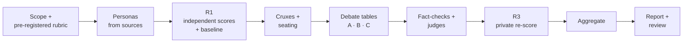

<div align="center">

# dinner-with-giants

**The dinner you'd never get invited to.**<br>
Seat the giants around your problem. Let them argue. Keep the receipts.

**English** · [简体中文](README.zh-CN.md)

[](https://github.com/Jerry-111/dinner-with-giants/actions/workflows/ci.yml)
[](LICENSE)
[](personas/)
[](#quick-start)


</div>

If you could have dinner with anyone, dead or alive, who would it be? This repo seats them around
your problem: 20 living giants of AI, technology and investing, and 6 from history, each rebuilt
from their own public record.

Every great adviser is biased, and that is the point. Jensen Huang reads a problem through the
cost of compute. Yann LeCun reads it through what a machine can learn by watching the world. Rich
Sutton asks what will scale with search and learning. Each of them spent decades on one path,
and the path is why their advice is worth having. Ask one model for "expert advice" and you get
an average of all of them, which is advice from nobody in particular.

**dinner-with-giants keeps those biases intact.** Each persona is a separate sub-agent, rebuilt from the
person's own public record (interviews, talks, essays, papers) with every claim labeled
`[quoted]`, `[synthesized]` or `[inferred]`. The personas score your problem alone first, then
argue at debate tables built around what they actually disagree on. Fresh agents fact-check the
debate while it happens. A no-persona baseline runs alongside, so you can see what the room added
over asking the model directly.

### Why a room, and not one guru

Even if you got dinner with one of them, it would last five minutes, and you would get one bias.
A career influencer or a famous mentor has the same limit: one path, no time for your details.

- **Your full context.** Your profile, preferences and a log of how past advice turned out live
  in plain Markdown in `workspace/`, which git ignores. Keep it in your Obsidian vault or sync it
  from Notion; every run reads it, so the room gets to know you over months, not minutes.
- **As much time as the problem needs.** A consult takes minutes; a full deliberation spends
  hours scoring, arguing, fact-checking and re-scoring your options.
- **Many biases instead of one.** One adviser's path skews the world you see. A room of
  different paths, kept apart until they argue, does not.
- **It improves with your tools.** The protocol runs in whatever coding agent and model you
  already use, so every new model and harness makes the same room sharper.

It is a protocol your coding agent runs. Claude Code or Codex launches the sub-agents. There is
no server, no SDK and no API key in this repository.

## What it's for

| Mode | You ask | You get | Time |
|---|---|---|---|
| `/consult` | "What would Karpathy, LeCun and Fei-Fei Li ask me first about this idea?" | One screen per persona, then where they disagree and what would settle it | minutes |
| `/review` | "Tear my pitch apart: Gurley, Huang, Collison." | Independent critiques, a cross-check wave, a ranked fix list, the calls you must make | 10–30 min |
| `/deliberate` | "Help me choose between these four options." | Pre-registered scores, debate tables, three fact-checks, judges, re-scores, a report | 1–6 hours |
| `/new-persona` | "Add someone to the room." | A sourced persona folder: dossier, views with a dated track record, card | about 30 min |

More recipes (pre-mortems, pitch rehearsal, mapping a contested field, getting argued out of a
belief, brainstorming from different paths): [docs/use-cases.md](docs/use-cases.md).

## See it work

### 20 AI leaders, 16 research directions, 7 debate tables

**[Read the run →](examples/runs/2026-10-28_ai-research-directions/)**

Twenty personas, from Jensen Huang, Dario Amodei and Demis Hassabis to Yann LeCun, Fei-Fei Li and
Kaiming He, scored 16 AI research directions on impact, how much of a bottleneck each one is,
where academia still has an edge, and timing. Then they argued at seven tables:

| Table | The crux |
|---|---|
| X1 | Is evaluation the best lever of the next decade, or are data, simulation and world models? |
| X2 | Does an academic lab training a narrow foundation model count as impact without third-party evaluation? |
| X3 | World models: has predictive representation been shown to drive decisions, or are valuations ahead of the evidence? |
| X4 | Agent self-improvement: a real compounding mechanism, or compute spend packaged as a story? |
| X5 | Physical AI: bet on abstract world models, or on generative action policies you can verify directly? |
| X6 | Can simulation replace scarce real robot data, especially for contact and the long tail? |
| X7 | Does RLVR teach new reasoning, or only polish and resample what the base model already has? |

What came out:

- **Evaluation science and embodied AI ranked first and second under every weighting.**
  Pre-training and multimodal generation ranked last, mostly on where academia has an edge and
  on timing.
- **The debate moved 48 scores**, each one citing the post that moved it and restating the
  argument. World models moved most: 11 of 18 personas changed their score.
- **A head-to-head flipped:** world models led generative action policies 11–9 before the
  debate and trailed 9–11 after.
- **The room is not the plain model.** Two no-persona baselines rated multimodal generation 7
  out of 10; the personas' median was 4. Across all directions the personas differed from the
  baselines by 0.91 and 0.97 points on average (mean absolute gap).

This run is adapted from a real run made for one user. It was translated from Chinese, and that
user's background, own candidate topics and personal questions were removed. Scores are as
recorded. Details in the run's README.

### Six historical figures advise a fictional student

Benjamin Franklin, Charles Darwin, Michael Faraday, Marie Curie, Ada Lovelace and Su Shi, rebuilt
from their own public-domain writings, debate a fictional student's next step: a big AI lab, a
biotech startup, a PhD, or an independent open-source year. Every file of the run is included,
from the frozen rubric to the reviewer's findings.
**[Read the run →](examples/runs/2026-11-14_alex-next-step/)**

## Meet the room

26 ready-made personas in [`personas/`](personas/), each with a dossier, domain views with a dated
prediction record, a machine-readable card and a sources table.

| Lens | Personas |
|---|---|
| Capital and value | [Michael Mauboussin](personas/C1_mauboussin/) · [Bill Gurley](personas/C2_gurley/) · [Vinod Khosla](personas/K1_khosla/) · [Patrick Collison](personas/K6_collison/) |
| Platforms and cost | [Jensen Huang](personas/C3_huang/) · [Jeff Dean](personas/K2_dean/) |
| Scale and verification | [Dario Amodei](personas/C4_amodei/) · [Andrej Karpathy](personas/K4_karpathy/) |
| Experience and world models | [Sergey Levine](personas/C5_levine/) · [Demis Hassabis](personas/C6_hassabis/) · [Rich Sutton](personas/K3_sutton/) · [Yann LeCun](personas/K5_lecun/) |
| Academia and evaluation | [Percy Liang](personas/M1_liang/) · [Graham Neubig](personas/M3_neubig/) |
| Agents | [Shunyu Yao](personas/M2_yao/) |
| Multimodal and generative | [Saining Xie](personas/M4_xie/) · [Kaiming He](personas/M5_kaiminghe/) · [Jun Zhu](personas/M8_zhujun/) |
| Spatial intelligence and robotics | [Fei-Fei Li](personas/M6_feifeili/) · [Russ Tedrake](personas/M7_tedrake/) |
| Historical | [Benjamin Franklin](personas/H1_franklin/) · [Charles Darwin](personas/H2_darwin/) · [Michael Faraday](personas/H3_faraday/) · [Marie Curie](personas/H4_curie/) · [Ada Lovelace](personas/H5_lovelace/) · [Su Shi](personas/H6_su_shi/) |

Every persona is a simulation based on public material, not the person's own words. None of the
people simulated here has reviewed or endorsed their persona. Want someone else at the table?
Run `/new-persona`.

## Quick start

You need [Claude Code](https://docs.anthropic.com/en/docs/claude-code) (or another coding agent
that can launch sub-agents) and Python 3.9+. Nothing to install from this repository.

```bash
git clone https://github.com/Jerry-111/dinner-with-giants.git
cd dinner-with-giants
claude
```

Then, in Claude Code:

```
/consult I'm in the second year of an ML PhD. Should I leave to join an AI startup? Ask Jensen Huang, Yann LeCun and Andrej Karpathy.
/review drafts/pitch.md with Bill Gurley, Jensen Huang and Patrick Collison
/deliberate
/new-persona Paul Graham
```

**Codex or another agent:** "Read `AGENTS.md`, then run a consult with `personas/C3_huang`,
`personas/K5_lecun` and `personas/K4_karpathy` on: …"

Your own context, personas and runs go in `workspace/`, which git ignores
([workspace/README.md](workspace/README.md)). Start with `/consult` or `/review`. A full run takes
hours and a lot of tokens ([time and cost](#time-and-cost)).

## How a full run works



Each box is one or more separate sub-agents handing files to each other. Details:
[docs/how-it-works.md](docs/how-it-works.md).

## Why it's different

- **Bias is kept, not averaged.** One sub-agent per persona; independent first scores;
  simultaneous posts; notes that never say who persuaded whom. A re-score has to cite the post that
  moved it and restate the argument in its own words.
- **Every claim is labeled** `[quoted]`, `[synthesized]` or `[inferred]`. Quotes are real and
  short. Famous lines that no primary source confirms are listed as "commonly attributed, not
  verified" and never quoted.
- **Experience arguments are first-class:** what I lived through → what it taught me → why it
  applies here → where the analogy breaks. They are judged on whether the analogy holds.
- **Interests are shown, never used as discounts.** "You have a stake, so you are wrong" is not an
  argument. Evidence can be challenged on its source.
- **Fact-checks are timed** to land before anyone re-scores, and an experience check compares
  each persona's stories with its own dossier.
- **It is measured:** a rubric frozen before scores arrive, a no-persona baseline on every run,
  and blind comparisons between protocol versions. A fidelity-test protocol for personas of living
  people is included; no fidelity results are published yet.

The story and numbers behind each rule: [docs/design-notes.md](docs/design-notes.md).

## How it compares

Several open-source projects and hosted products simulate advisers or run model councils. Each is built for a different job.

| Project | Who is in the room | How they work it out | How results are checked | Runs in |
|---|---|---|---|---|
| **dinner-with-giants** | 20 living public figures and 6 historical figures, rebuilt from cited sources; every claim labeled quoted, synthesized or inferred | Independent first scores, then debate tables built around cruxes, judged posts and private re-scores | Fact-checks between rounds, a no-persona baseline on every run, a fidelity-test protocol | Claude Code, Codex |
| [Roast Room](https://github.com/nateherkai/roast-room) | Business figures built from their public work | Three rounds (open, debate, vote) ending in a weighted, scored verdict, with a live web room and a PDF | A script checks every quote against the advisor's source notes | Claude Code, local web app |
| [nuwa-skill](https://github.com/alchaincyf/nuwa-skill) | One person at a time, distilled into a skill: mental models, heuristics, voice | Ask the persona directly; community tools such as zhuzi-skill stage debates between skills | Held-out questions and blind grading against an answer without the skill; published fidelity scores | Claude Code, Codex, Cursor and other Agent Skills runtimes |
| [LLM Council](https://github.com/karpathy/llm-council) | Models from several providers | First answers, anonymized peer ranking, a chairman's synthesis | Peer ranking | Local web app, OpenRouter |
| [Persona Council](https://github.com/tabreu8/persona-council) | Personas you build from your own evidence | Ask, fan-out, roundtables with anonymized digests, product walkthroughs | Planted-flaw evals against a single-pass baseline | Claude Code plugin, npm, Agent Skills |
| [AI Berkshire](https://github.com/xbtlin/ai-berkshire) | The methods of four value investors | Parallel research agents and a team-lead synthesis | Multi-source financial-data checks | Claude Code, Codex |
| [TradingAgents](https://github.com/TauricResearch/TradingAgents) | Trading-firm roles | Analyst team, bull/bear debate, risk team, portfolio manager | Backtests against a benchmark | Python package, CLI |
| [Delphi](https://www.delphi.co/) | Digital minds that experts build from their own content | One-on-one questions; several experts' answers can appear side by side | Answers draw on the expert's own material, which the expert controls | Hosted web service |

Pick by the job. Roast Room is built for a fast, visual business call; nuwa-skill for thinking with one person's frameworks; LLM Council for comparing models side by side; Persona Council for personas built from your own team's data; AI Berkshire and TradingAgents for markets; Delphi for asking an expert's own digital mind. dinner-with-giants is for slower decisions where you want the disagreement kept and every step checkable.

## Responsible use

The personas of living people here are public figures, simulated only within their public record.
Persona files and judges evaluate arguments and dated predictions, never a person's character.
Roles and deals carry sources and "as of" dates, and vendor links are disclosed: Claude is
trained by Anthropic, and two of the people simulated here work there. Do not present simulated
output as anything a real person said. If you are one of the people simulated here and want your
persona changed or removed, [open a content concern](https://github.com/Jerry-111/dinner-with-giants/issues/new?template=content_concern.yml):
we remove it, no reason needed. Full policy: [RESPONSIBLE_USE.md](RESPONSIBLE_USE.md).

## Repository map

| Path | What it is |
|---|---|
| [`AGENTS.md`](AGENTS.md) | The operating manual every coding agent reads first |
| [`CLAUDE.md`](CLAUDE.md) | Claude Code specifics; skills in `.claude/skills/` |
| [`protocol/`](protocol/) | The method, step by step, including the light modes (consult, review) |
| [`personas/`](personas/) | The persona library |
| [`templates/`](templates/) | User context, persona, run and round templates |
| [`tools/sim.py`](tools/README.md) | Validation, seating checks, aggregation, lints, privacy scan (standard library only) |
| [`schemas/`](schemas/) | JSON Schemas for every hand-off file |
| [`examples/`](examples/) | Two complete runs and a fictional user |
| [`docs/`](docs/) | Use cases, how it works, data formats, glossary, design notes, FAQ |
| [`workspace/`](workspace/README.md) | Yours. Git-ignored. |

## Time and cost

A consult takes minutes; a review 10–30 minutes; a panel of 3–6 personas about an hour. The
historical example (six personas, three tables) took about five hours end to end, an hour and a
half of it building the personas from sources. A full 20-persona run has taken about five and a
half hours. Persona agents are continued across rounds and carry large contexts, so token use is
high. Start small.

## Limits

- All personas are instances of one model, and so are the judges, scribes and fact-checkers.
  Their agreement is not independent evidence.
- A persona is a reconstruction from what was read, as of a date. It can be wrong about the
  person.
- Round isolation relies on instructions and the orchestrator's file hand-offs, not a sandbox.
- Fact-checks cover samples, not every claim.
- Output is structured disagreement, not professional advice.

## Contributing

Protocol changes backed by a run, tooling, templates, translations and new personas that follow
[RESPONSIBLE_USE.md](RESPONSIBLE_USE.md) are welcome. See [CONTRIBUTING.md](CONTRIBUTING.md).

## License and citation

[MIT](LICENSE) © 2026 Jerry-111. If you use the protocol or tooling in your work, please cite it
([CITATION.cff](CITATION.cff)).
