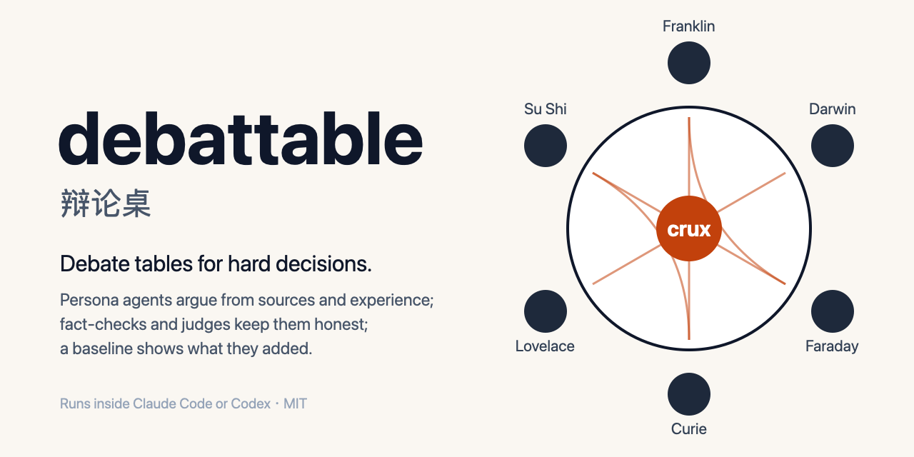
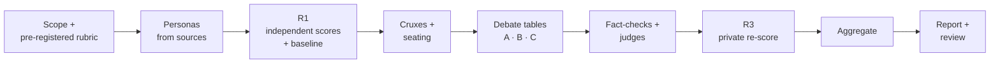

# debattable



**Debate tables for hard decisions.** Persona agents argue from sourced evidence and lived
experience, fact-checkers and judges keep them honest, and the numbers show what the personas
added over asking the model directly.

[](https://github.com/Jerry-111/debattable/actions/workflows/ci.yml)
[](LICENSE)

debattable is a protocol — instructions, templates, data formats and a small Python helper —
that your coding agent runs. In Claude Code or Codex it launches one real sub-agent per persona,
has each one score your options alone, seats them at debate tables around the questions they
actually disagree on, fact-checks the debate while it is happening, and writes a report that
keeps the disagreements intact.

There is no server, no SDK and no API key in this repository. Your agent is the runtime.

> **Bundled example.** Six historical figures — Benjamin Franklin, Charles Darwin, Michael
> Faraday, Marie Curie, Ada Lovelace and Su Shi — rebuilt from their own public-domain writings,
> debate a fictional student's next step: a big AI lab, a biotech startup, a PhD, or an
> independent open-source year. **[Read the run →](examples/runs/2026-11-14_alex-next-step/)**

## Why

- Ask one model once and you get one blended, hedged voice. Ask it to play five experts in one
  conversation and you get five costumes on the same opinion.
- Useful disagreement needs independent first positions, arguments grounded in who the people
  are, debate organized around what would settle it, and guards against herding and invented
  facts.
- You should also be able to tell whether any of it helped. Every run includes a no-persona
  baseline and reports the persona − baseline gap per option.

## Quick start

You need [Claude Code](https://docs.anthropic.com/en/docs/claude-code) (or another coding agent
that can launch sub-agents) and Python 3.9+. Nothing to install from this repository, and no
setup is needed to try `/consult` — it asks for whatever context it needs.

**Claude Code**

```bash
git clone https://github.com/Jerry-111/debattable.git
cd debattable
claude
```

Then, in Claude Code:

```
/consult What would Franklin, Curie and Su Shi ask me first if I left a stable lab job to start a company?
/deliberate          # a panel or a full run on your own decision
/new-persona         # build a persona from public sources
```

**Codex or another agent:** "Read `AGENTS.md`, then run a consult with
`examples/personas/H1_franklin` on: …"

Your own context, personas and runs go in `workspace/`, which git ignores
([workspace/README.md](workspace/README.md)).

Start with `/consult` or a small panel: a full run with many personas takes hours and a lot of
tokens (see [Time and cost](#time-and-cost)).

## How a run works



Each box is one or more separate sub-agents handing files to each other. Details:
[docs/how-it-works.md](docs/how-it-works.md).

## What is different here

- **Every claim is labeled** `[quoted]`, `[synthesized]` or `[inferred]`. Quotes are real and
  short; famous misattributed lines are checked and kept out.
- **Experience arguments are first-class:** what I lived through → what it taught me → why it
  applies here → where the analogy breaks. They are judged on whether the analogy holds.
- **Anti-herding is in the plumbing:** simultaneous posts, per-point accept/reject verdicts,
  interjections only with new arguments, persona-facing notes that never say who persuaded whom,
  and re-scores that must cite and restate the argument that moved them.
- **Interests are shown, never used as discounts.** "You have a stake, so you are wrong" is scored
  as not an argument; evidence can be challenged on its source.
- **Fact-checks are timed** to land before anyone re-scores.
- **It is measured:** a rubric frozen before scores arrive, a no-persona baseline, blind
  comparisons between protocol versions, and a fidelity test for personas of real people.

From the maintainers' earlier 20-persona runs (private, not included; numbers only):
switching to experience-first debate tables raised the share of sampled posts with a grounded
experience argument from 13% to 43% and widened the persona − baseline gap from 0.68 to 0.95
points on a 0–10 scale; in-debate fact-checks produced 15 retractions where the previous version
had none. The share of score changes justified only by "others changed too" did not improve
(about 10%). The bundled example run publishes its own numbers in full. The story behind each
rule: [docs/design-notes.md](docs/design-notes.md).

## Personas

| Kind | Example | Ships here? |
|---|---|---|
| `historical` | Franklin, Darwin, Faraday, Curie, Lovelace, Su Shi | Yes — `examples/personas/` |
| `fictional` / `archetype` | "A cash-flow-first investor" | Yes, as examples |
| `public_figure` | Anyone living with a public record | **No.** Build them in your own `workspace/` and follow [RESPONSIBLE_USE.md](RESPONSIBLE_USE.md) |

Every persona output says it is a simulation, not the person.

## Repository map

| Path | What it is |
|---|---|
| [`AGENTS.md`](AGENTS.md) | The operating manual every coding agent reads first |
| [`CLAUDE.md`](CLAUDE.md) | Claude Code specifics; skills in `.claude/skills/` |
| [`protocol/`](protocol/) | The method, step by step |
| [`templates/`](templates/) | User context, persona, run and round templates |
| [`tools/sim.py`](tools/README.md) | Validation, seating checks, aggregation, lints, privacy scan (standard library only) |
| [`schemas/`](schemas/) | JSON Schemas for every hand-off file |
| [`examples/`](examples/) | The persona pack, a fictional user, and a complete run |
| [`docs/`](docs/) | How it works, data formats, glossary, design notes, FAQ |
| [`workspace/`](workspace/README.md) | Yours. Git-ignored. |

## Time and cost

A consult takes minutes. A panel of 3–6 personas takes about an hour. The bundled example (six
personas, three tables, no overtime) took about five hours end to end — about an hour and a half of it building the six personas from sources — using 17 fresh sub-agents and about 31 continued persona turns. A full 20-persona run has taken about
five and a half hours; persona agents are continued across rounds and carry large contexts, so
token use is high. Start small.

## Limits

- All personas are instances of one model. Their agreement is not independent evidence.
- A persona is a reconstruction from what was read, as of a date.
- Round isolation relies on instructions and the orchestrator's file hand-offs, not a sandbox.
- Fact-checks cover samples, not every claim.
- Output is structured disagreement, not professional advice.

## Contributing

Protocol changes backed by a run, tooling, templates, translations and public-domain example packs
are welcome. See [CONTRIBUTING.md](CONTRIBUTING.md). Please do not submit personas of living
people or anything containing personal data.

## License

[MIT](LICENSE). 中文说明：[README.zh-CN.md](README.zh-CN.md)。
