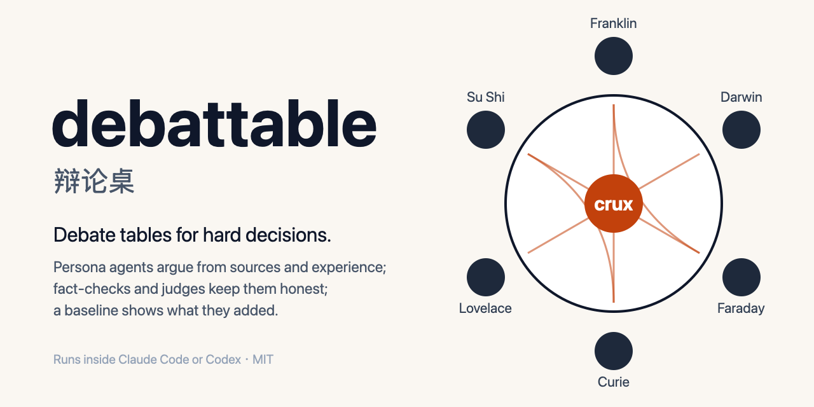

# debattable · 辩论桌



**给难做的决定开一张辩论桌。** 人物 agent 从有出处的证据和自己的经历出发论证，事实核查和裁判盯着他们，最后用数字告诉你：这些人物比直接问模型多带来了什么。

debattable 是一套协议：说明文档、模板、数据格式，外加一个小的 Python 工具。它由你自己的 coding agent 来跑。在 Claude Code 或 Codex 里，它给每个人物开一个真正的子 agent：先让每人独立给你的选项打分，再按他们真正有分歧的问题排辩论桌，辩论进行中做事实核查，最后写一份不抹平分歧的报告。

仓库里没有服务器，没有 SDK，没有 API key。你的 agent 就是运行时。

> **自带示例。** 六位历史人物从他们自己的、已进入公有领域的著作里重建出来：富兰克林、达尔文、法拉第、居里夫人、Ada Lovelace、苏轼。他们辩论一个虚构学生的下一步：去大厂 AI lab、加入生物创业公司、读博，还是独立做一年开源。**[看这一轮 →](examples/runs/2026-11-14_alex-next-step/)**

## 为什么做这个

- 直接问模型一次，得到的是一个被平均过、处处留余地的声音；让它在同一个对话里扮五个专家，得到的是同一个观点穿了五套衣服。
- 有用的分歧需要四样东西：
  - 各自独立的第一轮立场；
  - 建立在这个人是谁之上的论证；
  - 围绕“什么事实能分胜负”组织的辩论；
  - 防从众、防编造的机制。
- 还得能看出这一切到底有没有用。每一轮都带一个不扮任何人的基线分析师，报告里逐个选项列出“人物 − 基线”的差距。

## 快速开始

需要 [Claude Code](https://docs.anthropic.com/en/docs/claude-code)（或者别的能开子 agent 的 coding agent）和 Python 3.9+。本仓库不用装任何东西；试 `/consult` 也不用先配置，它缺什么会直接问你。

**Claude Code**

```bash
git clone https://github.com/Jerry-111/debattable.git
cd debattable
claude
```

然后在 Claude Code 里：

```
/consult 如果我辞掉实验室的稳定工作去创业，富兰克林、居里夫人和苏轼会先问我什么？
/deliberate          # 对你自己的决定跑一个小组或一整轮
/new-persona         # 从公开资料建一个人物
```

**Codex 或其他 agent：** “先读 `AGENTS.md`，再用 `examples/personas/H1_franklin` 对这个问题做一次 consult：……”

你自己的背景、人物和运行记录放在 `workspace/`，git 不跟踪（见 [workspace/README.md](workspace/README.md)）。

先从 `/consult` 或小组规模开始：人物多的一整轮要跑几个小时，token 消耗很大（见下文“时间与成本”）。

## 一轮怎么跑

见 [docs/how-it-works.md](docs/how-it-works.md)（英文，带流程图）。简单说：

1. 定题，预注册评分规则（rubric）：选项、维度、要正面回答的问题，人物交稿后不再改。
2. 从公开资料建人物：档案 A–I、领域判断与预测记录、机器可读卡片、来源表。
3. R1：每个人物和基线各自独立打分。
4. 一个没读过人物材料的新 agent 把分歧归成争点，排辩论桌。
5. 三轮具名辩论：开场、交锋（可插话、可来源质询）、收束；交锋之后、收束之前做一次事实核查。
6. 记录员写两版桌记录：给人物看的那版不写谁被谁说服。
7. R3：人物私下重估，每处改分都要引用并复述说服自己的那条论点。
8. 再做一次事实核查（含经历核查）；裁判按评分卡给每帖打分。
9. 脚本汇总，主笔写报告，独立审读，最后出一页读者版。

## 和别的项目哪里不一样

- **每条判断都有标注：**【原话】【归纳】【推断】（英文 `[quoted]` `[synthesized]` `[inferred]`）。引语必须真实、简短；常被误传的名言先查一手出处，查不到就不用。
- **经验论证是一等公民：** 我经历了什么 → 它教会我什么 → 为什么适用于这件事 → 类比在哪里可能不成立。按类比成不成立来评，不因为“主观”而打折。
- **防从众写进了流程：**
  - 同一轮同时发帖；
  - 逐条判定接受或不接受；
  - 插话只许带新论点；
  - 给人物看的记录不写谁说服了谁；
  - 改分必须复述论点。
- **利益只展示，不打折。** “你有利益所以你错”记为“不是论点”；证据可以按来源质询。
- **核查卡时间点：** 赶在人物改分之前送达。
- **有度量：**
  - 打分前冻结 rubric；
  - 无人物基线；
  - 协议版本之间做盲比；
  - 真人人物可以做保真度测试。

维护者早先的 20 人运行（私有，不在本仓库，只公布数字）里，换成“经验论证优先”的辩论桌之后：
- 带有扎实经验论证的帖子从 13% 升到 43%；
- 人物与基线的差距从 0.68 分升到 0.95 分（10 分制）；
- 辩论中的事实核查带来 15 处收回，上一版是 0 处。

“只因为别人也改了”的改分占比没有改善（约 10%）。每条规则背后的来龙去脉：[docs/design-notes.md](docs/design-notes.md)。

## 人物

| 类型 | 例子 | 本仓库带不带 |
|---|---|---|
| `historical` 历史人物 | 富兰克林、达尔文、法拉第、居里夫人、Lovelace、苏轼 | 带，在 `examples/personas/` |
| `fictional` / `archetype` 虚构、原型 | “只看现金流的投资人” | 带，作为示例 |
| `public_figure` 在世公众人物 | 任何有公开记录的在世者 | **不带。** 在你自己的 `workspace/` 里建，遵守 [RESPONSIBLE_USE.md](RESPONSIBLE_USE.md) |

每份人物产出都写明：基于公开材料的模拟，不是本人言论。

## 中文运行

在 `scope.md` 里把语言设成中文即可。工具认中文标注【原话】【归纳】【推断】【主笔】，也认中文的判定词（接受、不接受）。术语对照见 [docs/glossary.md](docs/glossary.md)。

## 仓库地图

| 路径 | 是什么 |
|---|---|
| [`AGENTS.md`](AGENTS.md) | 所有 coding agent 先读的操作手册 |
| [`CLAUDE.md`](CLAUDE.md) | Claude Code 专用补充；skill 在 `.claude/skills/` |
| [`protocol/`](protocol/) | 方法本身，一步一篇 |
| [`templates/`](templates/) | 用户背景、人物、运行、各轮的模板 |
| [`tools/sim.py`](tools/README.md) | 校验、排桌检查、汇总、lint、隐私扫描（只用标准库） |
| [`schemas/`](schemas/) | 每种交接文件的 JSON Schema |
| [`examples/`](examples/) | 人物包、虚构用户、一轮完整运行 |
| [`docs/`](docs/) | 原理、数据格式、术语表、设计笔记、FAQ |
| [`workspace/`](workspace/README.md) | 你自己的东西，git 不跟踪 |

## 时间与成本

- 一次 consult：几分钟。
- 3–6 人的小组：一小时左右。
- 自带示例（6 人、3 桌、不加时）：从头到尾约 5 小时，其中约 1.5 小时用来从一手资料建 6 个人物；共 17 个新开子 agent，约 31 次人物续接。
- 20 人的一整轮：约 5.5 小时。人物 agent 跨轮续接、上下文很大，token 消耗高。

## 局限

- 所有人物都是同一个模型的实例，他们之间的一致不是独立证据。
- 人物是按读到的材料、截至某个日期重建的。
- 同一轮里互不偷看，靠的是指令和主执行者的文件交接，不是沙箱。
- 事实核查是抽查，不是全查。
- 产出是结构化的分歧，不是专业建议。

## 参与

欢迎：带运行证据的协议改进、工具、模板、翻译、公有领域的历史人物示例包。见 [CONTRIBUTING.md](CONTRIBUTING.md)。请不要提交在世真人的人物，也不要提交任何含个人信息的东西。

## 许可

[MIT](LICENSE)。
