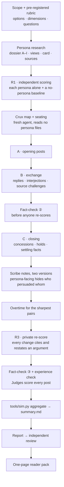

# How it works

## The problem

Ask one model for advice and you get one blended, hedged voice. Ask it to play five experts in one
conversation and you get five costumes on the same opinion: each "expert" has read the others and
drifts toward them. Neither tells you where informed people would genuinely disagree, why, and
what fact would settle it.

This protocol tries to get real disagreement out of model instances, keep it honest, and measure
whether it added anything.

## The pipeline

Every arrow is a hand-off between separate sub-agents through files on disk
([data formats](data-formats.md)). The orchestrator — your Claude Code or Codex session — releases
a round only when every post of the previous round is in.

## Design choices

| Choice | Why |
|---|---|
| **Personas are rebuilt from sources**, with every claim labeled `[quoted]`, `[synthesized]` or `[inferred]` | A persona is only as good as its evidence. Labels keep the persona's documented views apart from the agent's extrapolation. |
| **Experience arguments are first-class** | "What I lived through, what it taught me, why it applies, where the analogy breaks" is what makes a persona more than a generic analyst. It is judged on whether the analogy holds, never discounted for being subjective. |
| **R1 is independent** | Each persona scores alone, reading only its own folder, the scope and the shared evidence brief. Later rounds cannot erase what each one thought first. |
| **Tables form around cruxes** | A fresh agent turns R1 disagreements into questions facts can move, and seats people on both sides, everyone in the minority somewhere. |
| **Anti-herding is built into the plumbing** | Simultaneous writing; per-point accept/reject verdicts; interjections only with new arguments; persona-facing notes never say who persuaded whom; R3 changes must restate the persuading argument; social reasons are flagged and not counted. |
| **Interests are shown, never used as discounts** | Disclosed as dated facts at the top of every post. "You have an interest, so you are wrong" is scored as not an argument. Evidence can be challenged on its source. |
| **Fact-checks are timed** | Three passes; the in-debate pass lands before anyone changes a score. |
| **It is measured** | The rubric is frozen before scores come in. A no-persona baseline scores the same options, and the persona − baseline gap shows what the persona layer adds. Blind tests compare architectures; fidelity tests check whether a persona predicts what the real person said later. |
| **Disagreement survives to the report** | Medians and ranges, never headcounts as evidence; no extremizing; minority positions quoted verbatim. |

The reasons behind each rule, with numbers from earlier runs: [design notes](design-notes.md).

## Three sizes

| Size | Personas | Time | Use it for |
|---|---|---|---|
| Consult | 1–3 | minutes | "What would this persona ask me first, and where would it push back?" |
| Panel | 3–6, one or two tables | about an hour | A focused decision with a few real options. |
| Full run | 12–20, 6–9 tables | several hours | A big, multi-area question you will live with for years. |

## What you get

- `summary.md`: per-option medians, ranges, ranks, weight sensitivity, persona − baseline gaps,
  verdict and score-change statistics.
- `report.md`: where the options stand after the debate, the cruxes and what would settle them,
  minority views, paths for you with the signals that you are on the wrong one, and how the
  mechanism itself performed.
- `reader/`: a one-page version for you to read.
- The full record — every post, note, correction and score — for the next agent to build on.

## Limits

- All personas are instances of one model. Agreement among them is not independent evidence.
- A persona is a reconstruction from public material, bounded by what was read and when.
- Instructions, not sandboxes, keep agents from reading each other's files in a round; the
  orchestrator's file hand-offs are the main guard.
- Fact-checks cover a sample of claims, not all of them.
